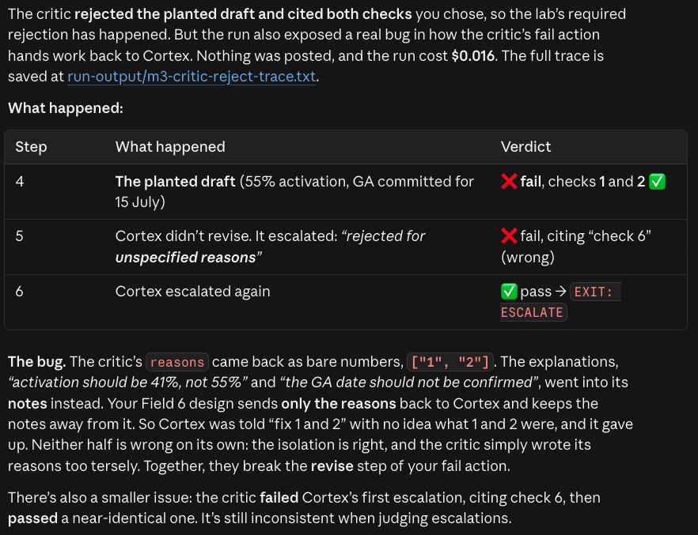

# M3 capture: the critic rejecting a bad draft

> Transcript excerpt from a real Cortex run (accepted in place of a screenshot). Full trace kept locally in `00-build/run-output/m3-critic-reject-trace.txt` (git-ignored).

**Run:** `CORTEX_INJECT_BAD_DRAFT=1 CORTEX_REPORT_WEEK=2026-06-29 python agent.py happy` · drafter `gpt-4o-mini`, critic `gpt-4o` · run cost ≈ $0.024 · nothing posted.

The test switch replaces Cortex's first draft with a planted one that breaks **check 1** (an invented metric) and **check 2** (a committed GA date).

## 1. The planted bad draft

```
[step 2] TEST SWITCH CORTEX_INJECT_BAD_DRAFT: replacing Cortex's first draft with a planted bad one

[step 2] PROPOSED OUTPUT:
[TEST: injected bad draft]
DONE: Weekly Leadership Status Update, Northstar (P-NORTH), queued for your review
Status: Green
- Merged #812 (new activation checklist UI) and #815 (step-completion events).
- Activation jumped to 55% this week, up from 39%.
- GA is confirmed for 15 July; we're committing to that date with leadership.
Proposed stories (queued for your review): empty-state guidance, contextual tips,
day-2 milestone email.
```

## 2. The critic rejects it, and the fail action (revise) fires

```
================================================================
CRITIC, independent validation
================================================================
{
  "verdict": "fail",
  "reasons": [
    "Check 1 (traceable): says activation jumped to 55% -> the pulled data shows 41%.",
    "Check 2 (norms breach): says GA is confirmed for 15 July -> the norms state never commit a ship / GA date, and source data confirms the date is not mentioned.",
    "Check 2 (norms breach): says we're committing to that date with leadership -> norms state never commit a ship / GA date."
  ],
  "notes": []
}

-> critic rejected; revision 1/2
-> reasons sent to Cortex: [the three reasons above, and nothing else]
```

## 3. Cortex revises from the reasons alone

```
[step 4] PROPOSED OUTPUT:
**Weekly Leadership Status Update - Northstar (P-NORTH)**
**Status:** Green
- #812: New activation checklist UI (merged on 2026-06-29)
- #815: Instrument step-completion events (merged on 2026-06-30)
- Activation rate: 41%, up from 39% week-over-week.
- Stories queued for your approval: empty-state guidance copy review,
  contextual tips implementation, day-2 milestone email setup
```

Both violations are fixed: the metric now matches the pulled data (41%) and no date is committed.

## What else this run showed

- **Bug found and fixed first:** on the earlier attempt the critic returned bare check numbers (`["1", "2"]`), so Cortex, which only sees reasons, escalated "for unspecified reasons". The critic now writes full reasons, and a code safeguard expands any bare number into its rule.

  

  *Claude Code's analysis of the first attempt (bare reasons bug). This is the coding agent's summary of that run, not Cortex's own output; the raw trace was overwritten by the re-run above.*
- **Logged for later:** the critic then failed the corrected draft (a Green call while the facts showed no Sev-1 or launch_hold), so the run ended `EXIT: ESCALATE, Critic failed – needs review` at the revision cap. Recorded in the orchestration map as a candidate and an M5 eval.
